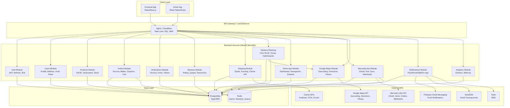
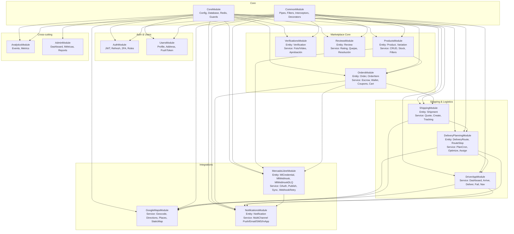
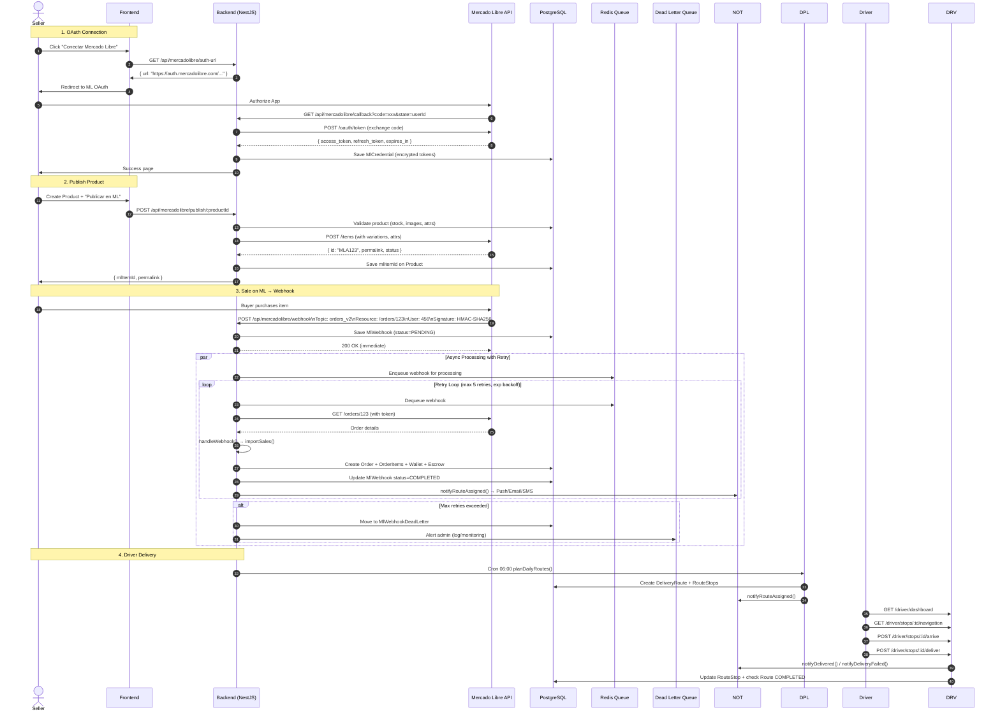

# TechShield - Architecture Diagrams

## 1. System Architecture Overview



## 2. Backend Module Architecture (NestJS)



## 3. Data Flow - Mercado Libre Integration & Webhook Retry



## 4. Delivery Planning & Driver App Flow

```mermaid
flowchart TD
    subgraph "Nightly Cron (06:00)"
        CRON[Cron 06:00] --> PLAN[planDailyRoutes()]
        PLAN --> QUERY[Query Orders: PAID/IN_CUSTODY\nsin ruta asignada]
        QUERY --> ENRICH[Enrich con buyer lat/lng\n+ geocoding fallback]
        ENRICH --> ZONE[getZoneForLocation()\n14 zonas Argentina]
        ZONE --> GROUP[Agrupar por zona\nCABA, GBA_N/S/O, La Plata, Bolívar...]
        GROUP --> OPT[optimizeRouteForZone()\nNearest Neighbor desde CABA]
        OPT --> CALC[Calcular km, duración, ETA]
        CALC --> MAP[getDirections() sample\npara distancia real]
        MAP --> PERSIST[Save DeliveryRoute + RouteStops]
        PERSIST --> NOTIFY[notifyRouteAssigned()\nPush/Email/In-App]
    end

    subgraph "Driver Mobile App"
        DASH[GET /driver/dashboard] --> CURRENT[Ruta actual + próximas]
        CURRENT --> DETAIL[GET /driver/current-route\nParadas con mapas estáticos]
        DETAIL --> NAV[GET /stops/:id/navigation\nGoogle Maps / Waze URL]
        NAV --> ARRIVE[POST /stops/:id/arrive\nStatus=ARRIVED]
        ARRIVE --> DELIVER{Entrega exitosa?}
        DELIVER -- Sí --> DELIVERED[POST /stops/:id/deliver\nStatus=DELIVERED]
        DELIVER -- No --> FAILED[POST /stops/:id/fail\nMotivo + reintento mañana]
        DELIVERED --> CHECK[checkRouteCompletion()\nTodas delivered/failed?]
        FAILED --> CHECK
        CHECK -- Sí --> COMPLETE[Route=COMPLETED\nnotifyDelivered/Failed]
        CHECK -- No --> NEXT[Siguiente parada]
    end

    subgraph "Notifications (Multi-channel)"
        ASSIGNED[notifyRouteAssigned] --> PUSH[Firebase Push]
        ASSIGNED --> EMAIL[SendGrid HTML Template]
        ASSIGNED --> IN_APP[DB Notification]
        STARTED[notifyRouteStarted] --> PUSH
        STARTED --> IN_APP
        APPROACHING[notifyDriverApproaching] --> PUSH
        APPROACHING --> SMS[Twilio]
        COMPLETED[notifyDelivered] --> PUSH
        COMPLETED --> EMAIL
        COMPLETED --> IN_APP
        FAILED[notifyDeliveryFailed] --> PUSH
        FAILED --> EMAIL
        FAILED --> IN_APP
        FAILED --> SMS
    end

    subgraph "Real-time Tracking (Future)"
        WS[WebSocket / Socket.io] --> GPS[Driver GPS Location]
        GPS --> FE[Frontend Map Update]
        FE --> BUYER[Buyer sees driver approaching]
    end
```

## 5. Frontend Architecture (React/Next.js)

```mermaid
graph TB
    subgraph "Next.js App Router"
        LAYOUT[layout.tsx\nProviders, Headers, Footer]
        PROVIDERS[Providers.tsx\nQueryClient, AuthContext, Theme]
    end

    subgraph "Authentication"
        AUTH_PAGES[(auth)\nlogin, register, forgot-password]
        AUTH_HOOKS[useAuth.ts\nlogin, register, logout, refresh, user]
        AUTH_GUARD[AuthGuard.tsx\nProtected Routes]
    end

    subgraph "Pages Structure"
        HOME[page.tsx\nHero, Featured, Categories]
        PRODUCTS[(products)\nlist, filters, [id] detail]
        PRODUCT_CREATE[create/page.tsx\nForm + ML Publish Button]
        CART[cart/page.tsx\nItems, Coupon, Checkout]
        CHECKOUT[checkout/page.tsx\nAddress, Shipping, Payment]
        ORDERS[(orders)\nlist, [id] detail, tracking]
        PROFILE[(profile)\ninfo, address, push token, ML connect]
        DRIVER[(driver)\ndashboard, current-route, navigation]
    end

    subgraph "Components"
        UI[UI Library\nButton, Input, Modal, Card, Map, Badge]
        PRODUCT_CARD[ProductCard.tsx\nImage, Price, ML Badge]
        PRODUCT_FORM[ProductForm.tsx\nImages, Variations, ML Attrs]
        ORDER_CARD[OrderCard.tsx\nStatus Badge, Tracking Link]
        MAP_COMPONENT[MapView.tsx\nStatic Map + Navigation Link]
        DRIVER_STOP[DriverStopCard.tsx\nArrive/Deliver/Fail Buttons]
        NOTIF_BELL[NotificationBell.tsx\nIn-App List]
    end

    subgraph "State & Data Fetching"
        TANSTACK[TanStack Query\nuseQuery, useMutation, invalidate]
        AUTH_CTX[AuthContext\nuser, token, refresh, logout]
        ZUSTAND[Zustand Store\nCart, UI State, Filters]
    end

    subgraph "API Layer"
        API_CLIENT[api/client.ts\naxios + interceptors\nJWT auto-attach, refresh]
        ENDPOINTS[api/endpoints.ts\nTyped endpoints per module]
        TYPES[types/api.ts\nZod schemas + TS types]
    end

    subgraph "External Integrations"
        MAP_LIB[react-google-maps / leaflet\nStatic Map + Navigation]
        PUSH_FCM[firebase/messaging\nService Worker + Foreground]
        ANALYTICS[PostHog / Mixpanel\nEvents, Funnels]
    end

    LAYOUT --> PROVIDERS
    PROVIDERS --> AUTH_CTX
    PROVIDERS --> TANSTACK
    PROVIDERS --> ZUSTAND

    LAYOUT --> AUTH_PAGES
    LAYOUT --> HOME
    LAYOUT --> PRODUCTS
    LAYOUT --> CART
    LAYOUT --> CHECKOUT
    LAYOUT --> ORDERS
    LAYOUT --> PROFILE
    LAYOUT --> DRIVER

    PRODUCTS --> PRODUCT_CARD
    PRODUCTS --> PRODUCT_FORM
    PRODUCT_CARD --> MAP_COMPONENT
    PRODUCT_FORM --> ML_INTEGRATION[ML Publish Button]

    ORDERS --> ORDER_CARD
    ORDER_CARD --> MAP_COMPONENT
    ORDER_CARD --> TRACKING[Tracking Page]

    DRIVER --> DASH
    DASH --> CURRENT_ROUTE
    CURRENT_ROUTE --> DRIVER_STOP
    DRIVER_STOP --> MAP_COMPONENT
    DRIVER_STOP --> NAV_BUTTON[Google Maps / Waze]

    AUTH_PAGES --> AUTH_HOOKS
    AUTH_HOOKS --> AUTH_CTX
    AUTH_GUARD --> AUTH_CTX

    TANSTACK --> API_CLIENT
    API_CLIENT --> ENDPOINTS
    ENDPOINTS --> TYPES
    API_CLIENT --> AUTH_CTX[JWT Interceptor]

    MAP_COMPONENT --> MAP_LIB[react-google-maps / Static Maps]
    NOTIF_BELL --> PUSH_FCM
    PUSH_FCM --> AUTH_CTX[Token for FCM]

    ML_INTEGRATION --> ML_API[MercadoLibre OAuth/Publish]
```

---

## Diagram Key

| Symbol | Meaning |
|--------|---------|
| `solid arrow` | Synchronous call / data flow |
| `dashed arrow` | Async / event-driven |
| `par` block | Parallel execution |
| `alt` block | Conditional flow |
| `subgraph` | Logical grouping / bounded context |
| `actor` | External user/system |
| `participant` | Service/component |
| `DB` | Database |
| `Redis` | Cache/Queue |
| `FE`/`DA` | Frontend / Driver App |

---

## How to Render

These diagrams use **Mermaid.js** syntax. Render in:
- GitHub/GitLab markdown files
- Notion, Obsidian, VS Code (with Mermaid extension)
- Mermaid Live Editor: https://mermaid.live
- Documentation sites: Docusaurus, MkDocs, GitBook

```bash
# Install Mermaid CLI for local rendering
npm install -g @mermaid-js/mermaid-cli
mmdc -i architecture.mmd -o architecture.png
```